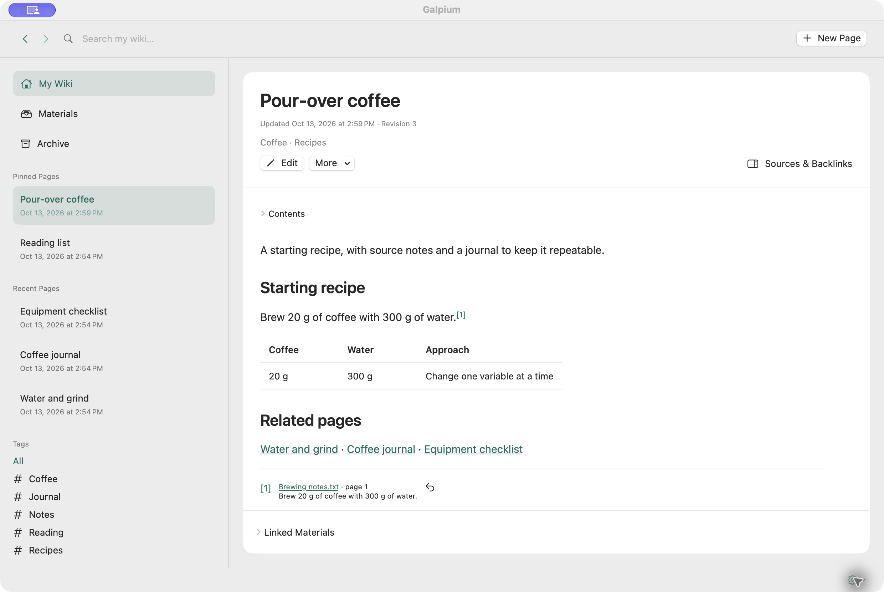
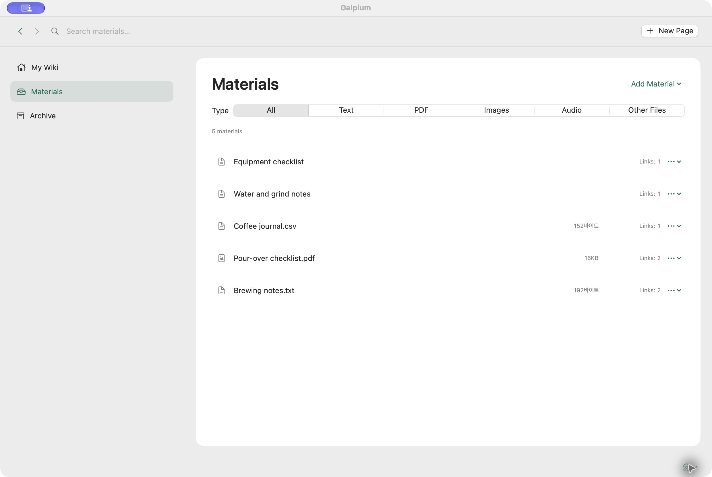

# Galpium

[English](README.md) · [한국어](README.ko.md) · **日本語**

GalpiumはmacOS向けの個人用Wikiです。Markdownのページをつなぎ、その根拠となる
資料を保存し、AIクライアントと連携して知識を整理できます。
ページ・原本ファイル・改訂履歴はMacのローカルライブラリに保存されます。

[ダウンロード](https://github.com/KimEJ/Galpium/releases/tag/v0.0.2) ·
[ユーザーガイド](docs/USER-GUIDE.ja.md) · [変更履歴](docs/CHANGELOG.ja.md)



*関連リンクや引用とともにページを読めます。*

## 主な機能

- **ページの作成とリンク。** Markdownを編集し、表や添付ファイルをプレビューできます。
  関連ページをリンクでつなぎ、被リンクを確認できます。
- **資料と引用。** テキスト・PDF・画像・音声・その他のファイルを資料一覧で管理します。
  引用脚注から原文の該当箇所を開けます。
- **ローカル検索。** キーワードや意味でページと資料を探せます。
  画像、PDFページの視覚的な内容、音声区間もテキストで検索できます。
- **履歴の保存。** 下書きを復旧し、改訂を比較して以前の内容を復元できます。
  ライブラリ全体のバックアップにも対応しています。
- **AI連携。** ChatGPTデスクトップや他のMCPクライアントから同じWikiを読み、
  更新できます。プロンプトやチャットリンクを成果物とともに資料として保存できます。

文書作成・保存・検索はオフラインで利用できます。AIによる文書作成は接続した
クライアントが行い、Wikiを読む際にはそのクライアントのデータ送信方針が適用されます。
画面は日本語・英語・韓国語に対応しており、設定で言語を選べます。



*原本資料をまとめ、参照数を確認できます。*

## インストール

ダウンロード版は **macOS 14以降を搭載したApple silicon Mac** に対応しています。

1. [Galpium-0.0.2-arm64.dmg](https://github.com/KimEJ/Galpium/releases/download/v0.0.2/Galpium-0.0.2-arm64.dmg)をダウンロードします。
2. **Galpium.app**を **Applications** フォルダに移動して起動します。
3. **新規ページ**で文章を書くか、**資料**からファイルを追加します。

検索モデルはアプリに同梱されています。macOSが初回の起動をブロックする場合は、
**システム設定 → プライバシーとセキュリティ**で起動を許可してください。

## ChatGPTデスクトップとの接続

GalpiumとChatGPTを **Applications** にインストールし、次の操作を行います。

1. [Galpium-Codex-Plugin-0.0.2.zip](https://github.com/KimEJ/Galpium/releases/download/v0.0.2/Galpium-Codex-Plugin-0.0.2.zip)をダウンロードして展開します。
2. **Galpium-Codex** フォルダを開きます。中には **Install Galpium Plugin.command**、
   **plugin** フォルダ、**LICENSE** と **NOTICE** ファイルがあります。
3. **Install Galpium Plugin.command**をダブルクリックし、ターミナルに
   **Galpium installed.**と表示されるまで待ちます。
4. ChatGPTを **⌘Q** で終了してから起動し直し、新しいローカルチャットで **@Galpium** を選択します。

インストーラはChatGPTに同梱されたランタイムを使用します。別途CLIをインストールしたり、
設定を手動で編集したりする必要はありません。接続状態、他のMCPクライアント、日常の操作は
[ユーザーガイド](docs/USER-GUIDE.ja.md)を参照してください。

## ソースからビルド

アプリ・コア・MCPサーバーはSwiftで実装されています。
macOS 14以降にXcode/Swift 6をインストールし、ソースをコンパイルします。

```sh
git clone https://github.com/KimEJ/Galpium.git
cd Galpium
swift build
```

検索モデルを含む実行用の `.app` バンドルを作成するには、
[開発・リリース手順](docs/RELEASE.md)を参照してください。
コードの構造と設計規則は[アーキテクチャ](docs/ARCHITECTURE.md)に記載しています。
シェルからの利用やLinux・Windows対応の開発については
[拡張ガイド](docs/PORTABILITY.ja.md)を参照してください。

## 対応範囲

Galpiumは個人用のローカルライブラリを使用し、クラウド同期機能はありません。
画像・音声の検索は関連する原本を探す機能であり、OCRテキスト・書き起こし・検証済みの
引用文は生成しません。読み取り可能なPDFテキストは引用できます。
動画の索引作成には対応していません。

## ライセンス

Galpiumのソースコード・プラグイン・ドキュメントは[Apache License 2.0](LICENSE)に従います。
同梱モデルや外部コンポーネントのライセンスは
[サードパーティに関する告知](THIRD-PARTY-NOTICES.md)に記載しています。
