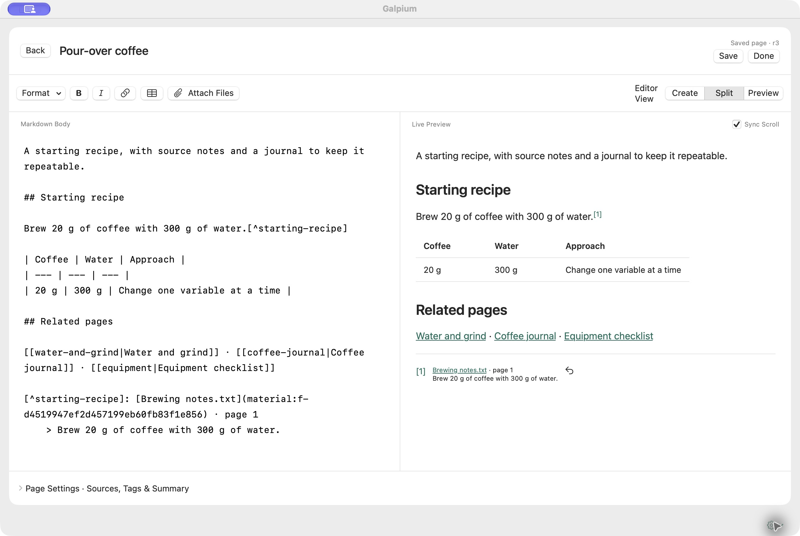

# Galpium ユーザーガイド

[English](USER-GUIDE.en.md) · [한국어](USER-GUIDE.md) · **日本語** ·
[README](../README.ja.md)

Galpiumでは、整理した知識を **ページ** にまとめ、その根拠となる原文やファイルを
**資料** として保存します。ページを編集しても、資料の原本は保持されます。
関連するページをリンクでつなぎ、引用を脚注として残すと、後から根拠を確認できます。

## はじめに

アプリのインストールは [READMEのインストール手順](../README.ja.md#インストール)を参照してください。
初回起動時は空のWikiが開きます。

1. **新規ページ** をクリックし、タイトルと本文を入力します。
2. **保存** または **⌘S** で保存します。
3. **完了** で閲覧画面に戻ります。

既存のファイルを使う場合は、サイドバーの **資料 → 資料を追加 → ファイルを読み込む…**
を選択します。資料の詳細にある **この資料から新規ページ** で、その資料を出典にした
新しいページを作成できます。

サイドバーの **マイWiki**、**資料**、**アーカイブ** で画面を切り替えます。
戻る・進むボタン、**⌘[ / ⌘]**、macOSのページ間スワイプで以前の画面に戻れます。
編集中は移動ジェスチャを利用できません。

## ページを書く

ページを開いて **編集** を選択します。**作成** では編集画面、**プレビュー** では
整形されたページを表示します。ウインドウの幅に余裕がある場合は、**分割** で
両方を並べて表示できます。



*Markdownを編集しながらプレビューを確認できます。*

**書式** メニューから見出し・リスト・引用・コード・リンク・表を挿入します。
**ファイルを添付** のほか、編集画面へのファイルのドラッグ＆ドロップや、
クリップボードからの画像の貼り付けも利用できます。
**ページ設定 · 出典・タグ・変更概要** では、タグ、固定、関連付ける資料、変更概要を
設定します。タグはカンマで区切ります。

**保存** は変更を記録して編集を続けます。**完了** は保存して閲覧画面に戻ります。
**戻る** を選択すると、未保存の変更をどう扱うか確認します。

## 資料を管理する

**資料** では、テキスト・PDF・画像・音声・その他のファイルを管理します。
コピーした文章は **資料を追加 → テキストを追加…** で保存し、ファイルは
**ファイルを読み込む…** で追加します。資料一覧へのドラッグ＆ドロップも使えます。
読み込めるファイルの上限は150 MiBです。

資料を開くと、原文またはプレビューが表示されます。PDFは **プレビュー / テキスト**
を切り替えられ、音声はプレーヤーで再生できます。ファイルの **開く** は外部アプリで
開き、**Finderで表示** は保存されたファイルの場所を表示します。

各資料の **…** メニューから、名前の変更・アーカイブ・復元・削除を選択します。
ファイル名を変更しても拡張子は保持されます。原本の内容は直接編集できないため、
変更したファイルは新しい資料として追加してください。リンク数をクリックすると、
その資料を参照するページ・資料・下書き・履歴を確認できます。
参照が残っている資料は削除できません。

## 検索する

**⌘K** で上部の検索欄に移動します。**マイWiki** ではページを、**資料** では資料を
検索します。資料は種類、ページはタグで絞り込めます。

キーワードに加えて内容の意味も検索するため、異なる表現や別の言語の質問でも関連する
項目を探せます。画像やPDFページの視覚的な内容、音声の区間も文章で検索できます。
PDFの検索結果を選ぶと該当ページが開き、音声の結果では該当区間の開始位置が開きます。
音声は自動再生されません。

資料を追加すると、検索用の索引をバックグラウンドで準備します。準備中や意味検索が
利用できない場合は、キーワード検索の結果を表示します。アーカイブではキーワードで
検索します。検索処理は、アプリに同梱されたモデルを使ってMac上で行います。

画像やスキャンPDFのOCR、音声の書き起こしは生成せず、動画の索引作成にも対応して
いません。類似した結果が見つかっても、質問の答えや正確な引用箇所とは限りません。
検索した原本を開いて内容を確認してください。

## リンクと引用脚注

ページの **その他 → リンクをコピー** で `[[page-slug]]` 形式のリンクをコピーし、
別のページに貼り付けます。**出典と被リンク** では、関連する資料と、このページに
リンクしているページを確認できます。

原文の一節を引用するには、次の手順を使います。

1. ページを編集し、**ページ設定 · 出典・タグ・変更概要** を開きます。
2. 資料を探して **引用…** を選択します。
3. 原文のページを選び、引用する一節をそのままコピーして入力します。
4. **脚注を挿入** をクリックし、ページを保存します。

引用する一節が原文に存在する場合にだけ、脚注を挿入できます。閲覧画面の脚注番号を
クリックすると引用を確認でき、**原文を表示** で該当箇所を開けます。資料名の変更や
検索索引の再作成後も、保存した引用は保持されます。画像・音声の検索結果そのものを、
検証済みの引用文として使うことはできません。

補足説明のための通常の脚注も使用できます。

```markdown
本文に脚注を付けます。[^note]

[^note]: 補足説明です。
```

外部のWebリンクは開けます。外部画像は自動ダウンロードせず、リンクとして表示します。

## AIとの作業記録を残す

AIでページを整理した場合は、依頼したプロンプトとチャットへのリンクをテキスト資料に
保存し、ページに関連付けられます。後から依頼の範囲や元の会話を確認するために使います。

テキスト資料の **出典URL · 任意** には、Webアドレスまたは既存のローカルチャットの
`codex://threads/<chat-UUID>` リンクを入力します。対応するチャットリンクがある場合は、
資料詳細の **ChatGPTで開く** から会話に戻れます。リンクを開くには、対象の
デスクトップアプリとチャットにアクセスできる必要があります。

## 下書き・履歴・アーカイブ

入力を少し止めると、編集内容が端末に下書きとして保持されます。下書きの保持は
ページの保存とは別です。次回起動時に **保存された下書き → 復旧** で開き、
保存してください。

AIや別のウインドウが同じページを先に変更した場合は、最新の内容と比較する画面が
開きます。**下書きを新しい改訂として保存** を選択すると、確認した下書きが
新しい改訂として保存され、以前の内容は履歴に残ります。

**その他 → 履歴** では、過去の改訂と現在のページを比較し、復元できます。
復元すると、過去の内容から新しい改訂を作成します。既存の履歴は削除しません。
**ページをアーカイブ…** はページと履歴を保持したままアーカイブに移します。
アーカイブの **ページ / 資料** フィルタから、復元する項目を探せます。

設定メニューの **Wikiの構造を確認** は、リンク切れ・孤立したページ・未整理の原本・
添付ファイルの不足などを表示します。文章の事実関係や解釈は、原文を読んで
別途確認してください。

## バックアップと書き出し

**Wiki → 全体バックアップ…** で保存先を選択します。バックアップには、ページ・
資料・すべての改訂履歴・添付ファイルの原本が含まれます。作成されたバックアップ
フォルダは、全体をまとめて保管してください。

**バックアップを読み込む…** は、バックアップを現在のライブラリに追加します。
同じ項目がすでに存在する場合は再利用し、端末に保存された下書きは上書きしません。
同じ識別子で内容が異なる場合は読み込みを中断し、既存の内容を保持します。

**その他 → Markdownを書き出す…** は、一つのページの本文をファイルに保存します。
内部リンク・資料・引用・履歴も一緒に保持するには、全体バックアップを使ってください。

## AIと連携する

ChatGPTデスクトップのローカルチャットに接続するには、GalpiumとChatGPTを
**Applications** にインストールしてからプラグインを追加します。

1. [プラグインZIP](https://github.com/KimEJ/Galpium/releases/download/v0.0.2/Galpium-Codex-Plugin-0.0.2.zip)をダウンロードして展開します。
2. **Galpium-Codex** フォルダを開きます。中には **Install Galpium Plugin.command**、
   **plugin** フォルダ、**LICENSE** と **NOTICE** ファイルがあります。
3. **Install Galpium Plugin.command** をダブルクリックし、**Galpium installed.** と表示されるまで待ちます。
4. ChatGPTを **⌘Q** で終了して再起動し、新しいローカルチャットで **@Galpium** を選択します。

インストーラが接続設定を登録するため、別途CLIをインストールしたり、設定ファイルを
編集したりする必要はありません。接続したチャットでは、資料を探し、関連するページを
整理したり新しく作成したりするよう依頼できます。プラグインは、資料の引用と
既存ページの改訂履歴を保持するようAIに案内します。

Macのメニューバーの本アイコンが開いている場合は、MCPクライアントが接続中です。
メニューからクライアント一覧と処理状況を確認できます。接続に問題がある場合は、
**設定 → AI連携 → MCP接続を確認** でアプリの接続を確認し、クライアントを
再接続してください。

保存と検索はローカルで行います。接続したAIクライアントがWikiの内容を読む場合は、
そのクライアントとモデル提供者のデータ送信ポリシーが適用されます。

### 他のMCPクライアント

stdio MCP接続に対応するクライアントには、次の実行ファイルを登録します。
設定形式はクライアントに合わせて変更してください。

```json
{
  "mcpServers": {
    "galpium": {
      "command": "/Applications/Galpium.app/Contents/MacOS/galpium-mcp"
    }
  }
}
```

別のライブラリを指定する場合は、`"args": ["--library", "/absolute/path/to/library"]`
を追加します。シェルからの利用や直接連携は [拡張ガイド](PORTABILITY.ja.md)を参照してください。

## 言語とライブラリの設定

下部の歯車の **設定 → アプリ設定…** または **⌘,** から設定を開きます。
**言語** は初期設定でシステム言語に従い、한국어・English・日本語を選択できます。
画面とメニューの言語だけが変わり、ページや資料は翻訳されません。

既定のライブラリは `~/Library/Application Support/Galpium/` です。
**ライブラリを開く・作成…** で既存のライブラリまたは新しい空のフォルダを選択します。
以前のフォルダは保持されます。ライブラリを変更した後は、MCPクライアントを再接続して
新しいライブラリを使用してください。MCPにライブラリのパスを別途指定している場合は、
そのパスが優先されます。

アップデート前に全体バックアップを作成することを推奨します。新しい検索モデルに
合わせて索引を再作成しても、ページ・原本・引用・履歴は保持されます。
バージョンごとの変更は [変更履歴](CHANGELOG.ja.md)を参照してください。
クラウド同期機能は提供していません。

ウインドウを閉じてもアプリはバックグラウンドで動作します。Dockまたはメニューバーの
**Galpiumを開く** から再び開き、**⌘Q** で終了します。
